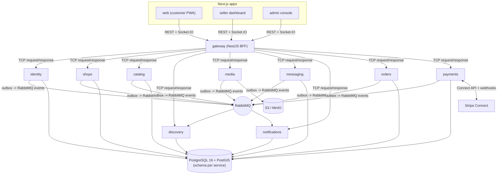

# African Market UAE: Product & Technical Plan

Source of truth: the Claude Doc at https://claude.ai/code/artifact/b4f4661f-4a7a-42da-9183-d769a134e110 (snapshot 2026-10-09, rev 30). Owner: Henson.

## Summary

We build a location-first marketplace where African sellers in the UAE list their shops, branches and the areas they serve, and customers find them by distance, then contact, chat or buy. Discovery ships first because it is the gap people feel today; checkout follows as an opt-in per shop.

Key choices made in this plan (all reversible, confirmed in Decisions):

- **Frontend: Next.js** (App Router). Shop and product pages need server rendering for Google search and WhatsApp link previews, `next-intl` handles Arabic right-to-left well, and the hiring pool is larger than Remix's.
- **Backend: NestJS microservices in an Nx monorepo**, starting with 6 deployable services and splitting further only when load or team size demands it.
- **Data: PostgreSQL 16 with PostGIS and TypeORM**, one cluster with a schema per service at launch.
- **Hosting: a UAE cloud region** (AWS me-central-1 or Azure UAE North) to keep personal data in-country.
- **Payments: Stripe Connect only, with the shop as merchant of record so the platform never holds seller funds**, plus cash on delivery, enabled per shop.

## Users and core journeys

Four roles cover everything in the brief; one account can hold several (a seller is also a customer).

| Role | What they do | Key screens |
|---|---|---|
| Customer | Finds shops and products near them, contacts sellers, chats, orders and pays | Home map, search, shop page, product page, chat, cart, orders |
| Shop owner | Registers the business, adds branches and service areas, lists products and services, turns on checkout, gets paid | Onboarding, branches, catalogue, inbox, orders, payouts, settings |
| Branch staff | Answers chats and handles orders for one or more branches, without access to payouts | Inbox, orders, stock for their branch |
| Platform admin | Verifies shops, moderates listings and reviews, resolves disputes, manages categories | Admin console |

The three journeys that define the product:

1. **Find and contact.** Customer opens the app, location is detected or picked on the map, nearby shops show on a map and list, customer opens a shop and taps WhatsApp, call, email or chat.
2. **List a shop.** Owner signs up with phone OTP, creates the shop, adds each branch with a map pin, opening hours and a service area (radius or drawn zone), adds products, submits for verification.
3. **Buy.** Customer adds items from one shop, picks pickup at a branch or delivery to an address inside the service area, pays by card, Apple Pay or cash on delivery, and tracks the order while chatting with the shop.

## Feature scope

The MVP is a verified directory with map search and direct contact; chat and checkout come in the next two releases so sellers get value before they must operate orders.

| Area | MVP (Phase 1) | Next (Phases 2 to 3) | Later (Phase 4) |
|---|---|---|---|
| Accounts | Phone OTP, email login, Google and Apple sign-in, customer and seller profiles | Branch staff invites and permissions | UAE Pass login for verified sellers |
| Shops | Shop profile, logo, gallery, categories, country-of-origin tags, opening hours, verification badge | Multiple owners, shop policies, paid Boosts | Seller subscriptions and featured placement |
| Branches | Map pin, address, Makani number (Dubai), service area as radius or polygon, pickup and delivery flags | Per-branch stock and prices | Delivery partner integration |
| Catalogue | Products and services with photos, price in AED, variants, availability | Bulk CSV import, promotions | Bookings for services (salons, tailoring) |
| Discovery | Nearby map and list, keyword search, filters (category, origin country, open now, delivers to me), shop and product pages | Favourites, recently viewed, recommendations | Personalised feed |
| Contact | WhatsApp click-to-chat, tap to call, email | In-app chat with photos, read receipts, push notifications | WhatsApp Business API templates |
| Trust | Basic KYC for every seller (ID and selfie check), admin verification, report listing | Ratings and reviews tied to orders or chats | Dispute centre |
| Commerce | None | Cart, checkout, card, Apple Pay, Google Pay, cash on delivery, order tracking, refunds, seller payouts | BNPL (Tabby, Tamara), coupons |
| Languages | English and Arabic with right-to-left layout | French (many West and Central African users) | Swahili, Amharic if demand shows |

## Architecture

Three Next.js apps talk to one NestJS gateway; behind it, services own their data and share changes through an event bus, all in one Nx monorepo with one CI pipeline.



Frontends never call a service directly, and services never read each other's tables, so any service can be rewritten or scaled alone.

How the parts talk:

- **Frontend to gateway:** REST with an OpenAPI spec; a typed client is generated into `libs/api-client` so the apps and the API cannot drift. Shop and product pages are server-rendered by Next.js for search engines and link previews.
- **Gateway to service:** NestJS microservice request-response over TCP inside the private network (switch to gRPC if payloads or latency demand it).
- **Service to service:** events on RabbitMQ through the outbox, for anything that can be eventually consistent (search index, notifications, payouts).
- **Chat:** clients hold a Socket.IO connection through the gateway to `messaging`.

Monorepo layout:

```
apps/
  web/          Next.js customer app (PWA)
  seller/       Next.js seller dashboard
  admin/        Next.js admin console
  gateway/      NestJS BFF
  identity/  shops/  catalog/  discovery/  media/
  messaging/  notifications/  orders/  payments/
libs/
  contracts/  auth/  database/  geo/  i18n/  ui/  api-client/
infra/          Terraform, docker-compose for local
```

Why not more services: each extra deployable adds a pipeline, alerts and a failure mode. Nine is already generous for a small team; a modular split inside a service is the first step before a new one.

## Services

Each service owns its schema and talks to others through the event bus or, for reads that must be fresh, a synchronous request. Six services ship in the MVP; the other three join when their phase starts.

| Service | Owns | Main events published | Phase |
|---|---|---|---|
| `gateway` (BFF) | REST API for the three frontends, auth guard, rate limiting, OpenAPI docs, request fan-out | none | 1 |
| `identity` | Users, credentials, OTP, sessions and refresh tokens, roles, shop memberships | `user.registered`, `membership.changed` | 1 |
| `shops` | Shops, branches, opening hours, service areas, verification status | `shop.created`, `shop.verified`, `branch.updated` | 1 |
| `catalog` | Categories, products, services, variants, prices, branch availability | `product.upserted`, `product.removed` | 1 |
| `discovery` | Geo search read model (shops, branches, products joined), ranking, filters | none (consumes the above) | 1 |
| `media` | Presigned uploads to object storage, image resizing, CDN URLs | `media.ready` | 1 |
| `messaging` | Conversations, messages, attachments, read state, WebSocket gateway | `message.sent` | 2 |
| `notifications` | Email, SMS, push and WhatsApp templates, user preferences, delivery log | none | 2 |
| `orders` | Carts, orders, fulfilment status, reviews tied to orders | `order.placed`, `order.status_changed` | 3 |
| `payments` | Stripe Connect onboarding, payment intents, application fees, webhook mirror, refunds, payout status | `payment.succeeded`, `payout.sent` | 3 |

Shared code lives in Nx libraries, not services: `libs/contracts` (event and DTO types), `libs/auth` (JWT guard, role decorators), `libs/database` (TypeORM base entities, migrations runner), `libs/geo` (PostGIS helpers) and `libs/i18n`.

Rules that keep this healthy:

- No service reads another service's tables. Discovery builds its own read model from events.
- Every event is written to an outbox table in the same transaction as the change, then relayed to the bus, so nothing is lost if the bus is down.
- Consumers are idempotent (event id stored on handle) because the bus delivers at least once.

## Data model

The branch, not the shop, is the unit customers find: it carries the location, hours and service area, while the shop carries the brand and the payment settings. All ids are UUIDs, all money is stored as integer fils (1 AED = 100 fils) with a currency column, and every table has `created_at`, `updated_at` and soft-delete `deleted_at`.

| Entity | Service | Key fields |
|---|---|---|
| `user` | identity | phone (E.164, unique), email, name, preferred_language, avatar_media_id, status |
| `credential` | identity | user_id, type (password, google, apple), secret_hash or provider_subject |
| `shop_member` | identity | user_id, shop_id, role (owner, manager, staff), branch_ids |
| `address` | identity | user_id, label, emirate, area, building, flat, makani, location `geography(Point)` |
| `shop` | shops | name, slug, description_en, description_ar, logo, categories, origin_countries, trade_license_no, license_expiry, kyc_status, verification_status, stripe_account_id, contact_whatsapp, contact_phone, contact_email, checkout_enabled, cod_enabled |
| `branch` | shops | shop_id, name, emirate, area, address_line, makani, location `geography(Point,4326)`, service_area `geography(MultiPolygon)` or service_radius_m, pickup, delivery, delivery_fee_fils, min_order_fils |
| `opening_hours` | shops | branch_id, weekday, opens_at, closes_at, plus `special_hours` for Eid and holidays |
| `category` | catalog | parent_id, slug, name_en, name_ar, name_fr, kind (product, service) |
| `product` | catalog | shop_id, category_id, type (product, service), title, description (per language), origin_country, images, status |
| `variant` | catalog | product_id, sku, options (size, weight), price_fils, compare_at_fils |
| `branch_listing` | catalog | branch_id, variant_id, in_stock, quantity, price_override_fils |
| `conversation` | messaging | customer_id, shop_id, branch_id, last_message_at, related order or product |
| `message` | messaging | conversation_id, sender_id, body, attachments, sent_at, read_at |
| `order` | orders | number, customer_id, shop_id, branch_id, fulfilment (pickup, delivery), address snapshot, status, subtotal, delivery_fee, vat, total, payment_method |
| `order_item` | orders | order_id, variant_id, title snapshot, unit_price_fils, quantity |
| `review` | orders | order_id or conversation_id, shop_id, rating 1 to 5, text, moderation_status |
| `payment` | payments | order_id, provider, provider_ref, amount, status, captured_at, refunded_amount |
| `ledger_entry` | payments | shop_id, type (charge, fee, refund, payout), amount, stripe_object_id; a read-only mirror of Stripe events, not balances we hold |
| `payout` | payments | shop_id, stripe_payout_id, amount, status (mirrored from Stripe for the seller dashboard) |
| `notification` | notifications | user_id, channel, template, payload, status, sent_at |

TypeORM notes:

- Migrations only (`synchronize: false` everywhere), generated per service and run in CI before deploy.
- PostGIS columns use `type: 'geography', spatialFeatureType: 'Point', srid: 4326` with a GiST index; distance and containment queries go through a small repository in `libs/geo` using `ST_DWithin` and `ST_Covers`.
- Orders and stock reservations use explicit transactions with `SERIALIZABLE` or row locks on stock; never rely on entity listeners for money.

## Location discovery and search

A customer sees a shop if the customer's point is within the branch's service area, or within a chosen travel radius of the branch for pickup. PostGIS answers this in one indexed query, which is enough well past launch scale; a search engine joins only when text relevance needs it.

How a search works:

1. The client sends a point (device GPS, a saved address, or a pin dropped on the map) plus filters.
2. `discovery` runs `ST_Covers(service_area, point)` for delivery and `ST_DWithin(location, point, radius)` for pickup, joined to the denormalised read model.
3. Results are ranked by a weighted score of distance, open now, verified badge, rating and listing completeness, with deterministic pagination by cursor.
4. Map view uses the same query with a bounding box and server-side clustering at low zoom levels.

Text search starts with Postgres full-text search plus `pg_trgm` for typos, using an `unaccent` config so "egusi", "Egusi" and near spellings match. Move to OpenSearch (available in the UAE AWS region) when the catalogue passes roughly 100,000 products or when Arabic stemming quality becomes a complaint.

Maps and addresses:

- **Map provider: Google Maps Platform** for the map, Places autocomplete and geocoding; its UAE coverage is the best and users already know it. Keep the map behind an adapter so Mapbox or MapLibre with OpenStreetMap tiles can replace it if cost grows.
- UAE addresses are informal (area, building, landmark) and many buildings lack street numbers, so the pin on the map is the source of truth and the text is for the courier. Capture the Makani number in Dubai where the seller knows it.
- Location permission is optional: fall back to a chosen emirate and area, then IP-based city.

## Contact, chat and notifications

Direct contact needs no backend at all and ships on day one; in-app chat is a real-time service and ships in Phase 2.

**Direct contact (Phase 1).** Each shop and branch stores a WhatsApp number, phone and email. Buttons build `https://wa.me/971XXXXXXXXX?text=…` with a prefilled message naming the product and a link back, `tel:` and `mailto:` links. Every tap is logged as a contact event so sellers see leads in their dashboard and we can measure demand before chat exists.

**In-app chat (Phase 2).**

- Socket.IO through a NestJS WebSocket gateway in `messaging`, with the Redis adapter so several instances share rooms.
- One conversation per customer and shop, optionally pinned to a branch, product or order; staff assigned to that branch see it in a shared inbox.
- Messages are stored in Postgres (partition the `message` table by month once it grows); photos go through `media`.
- Offline recipients get a push notification, then an email digest if unread after a set delay.
- Safety: rate limits, block and report, and a filter that warns customers when a message asks them to pay outside the platform once checkout exists.

**Notifications.** One `notifications` service decides channel by user preference and urgency:

| Channel | Provider (suggested) | Used for |
|---|---|---|
| Push | Firebase Cloud Messaging (web push now, mobile later) | New message, order updates |
| Email | Amazon SES in the UAE region, or Postmark | Receipts, verification results, digests |
| SMS | A UAE-licensed aggregator or Twilio with a registered sender ID | OTP codes |
| WhatsApp | WhatsApp Business Platform via Meta or a BSP such as 360dialog | OTP fallback, order updates (Phase 4) |

WhatsApp is the channel UAE users answer fastest, so it is worth moving OTP there early if SMS costs or delivery become a problem.

## Checkout and payments

Decided: online payments run only on **Stripe Connect**, with each shop as the merchant of record, so customer money goes straight to the shop's Stripe balance and the platform never holds or moves seller funds. If Stripe Connect cannot be used for our setup in the UAE, online checkout does not ship and shops stay contact-only plus cash on delivery.

**How the money flows.**

1. A shop with checkout enabled has a Stripe connected account it onboarded through Stripe's hosted flow (identity, bank account, business details).
2. At checkout we create a **direct charge** on the shop's connected account with an `application_fee_amount` equal to our commission.
3. Stripe settles the sale in the shop's balance, sends our fee to the platform account, and pays the shop out to its bank on the shop's own payout schedule.
4. Refunds and disputes are raised against the shop's account; the platform can refund its own fee when an order is cancelled.

Use the connected-account setup where the shop is liable for refunds, disputes and Stripe fees (Stripe's Standard-style configuration). Destination charges and Express-style accounts route funds through the platform's balance and make the platform responsible for losses, which is what you want to avoid.

**Gate before building:** confirm in writing with Stripe that a UAE platform account can use Connect with UAE connected accounts, direct charges and application fees. Stripe supports UAE businesses, but Connect capabilities vary by country and should not be assumed.

**Per-shop switches.**

- `checkout_enabled` requires basic KYC passed, a trade licence validated by an admin, and Stripe reporting the connected account as able to take charges and receive payouts.
- `cod_enabled` can be on for any verified shop; no money touches the platform.
- Carts are single-shop, because each charge belongs to one connected account.

**Order lifecycle.** `pending_payment` to `paid` (or `cod_confirmed`) to `accepted` to `ready_for_pickup` or `out_for_delivery` to `completed`, with `cancelled` and `refunded` branches. Stock is reserved at checkout and released after a payment timeout.

**Engineering notes.**

- Stripe Payment Element on the web for cards, Apple Pay and Google Pay; card data never touches our servers (PCI DSS SAQ A).
- Stripe is the source of truth for balances. We store Stripe ids and mirror webhook events (`account.updated`, `payment_intent.succeeded`, `charge.refunded`, `charge.dispute.created`, `payout.paid`) for the seller and admin dashboards, verified by signature and processed idempotently. No in-house balance ledger.
- Shops are responsible for VAT on their own sales. Our commission is platform revenue, invoiced to shops with VAT once the platform is VAT-registered.
- Delivery stays with sellers for now. Orders keep a `fulfilment_provider` field (`seller` today) behind a `DeliveryProvider` interface so the future delivery product and third-party couriers plug in without reworking orders.

## UAE specifics

The items below come from general knowledge of the UAE market as of 2026, not from a fresh legal review; treat the regulatory rows as a checklist to confirm with a UAE business setup consultant or lawyer before launch.

| Topic | What it means for us | Action |
|---|---|---|
| Platform licence | Operating a marketplace needs a UAE trade licence with an e-commerce or online marketplace activity, from a mainland economic department (for example Dubai DET) or a free zone such as DMCC, IFZA or Meydan | Pick the licence before signing payment providers; they ask for it |
| Seller licensing | Shops need their own trade licence; home-based sellers can use emirate home-business permits (for example Dubai's home business licence) | Collect licence number and expiry at verification; contact-only listings need basic KYC; checkout needs a validated licence |
| E-commerce law | Federal Decree-Law 14 of 2023 on trading by modern technology sets duties for platforms: accurate seller info, consumer disclosures, records | Show seller legal name and licence on shop pages; keep order records |
| Consumer protection | Federal Law 15 of 2020 covers returns, refunds, pricing in AED and Arabic information | Clear refund policy per shop, prices VAT-inclusive in AED |
| Data protection | Federal Decree-Law 45 of 2021 (PDPL) requires consent, purpose limits, breach notification and limits on transfers abroad | Host in a UAE region, consent screens, privacy policy in English and Arabic, data export and delete on request |
| VAT | 5% VAT; mandatory registration above AED 375,000 taxable supplies a year | Prices shown VAT-inclusive; register the platform when commission revenue nears the threshold |
| Food products | Many listings will be imported foodstuffs; Dubai Municipality and other emirates' food authorities require registered, labelled products | Food category needs a seller declaration and admin review; restricted items list (fresh meat, unlabelled goods, herbal medicines) |
| Prohibited items | Some goods common in diaspora stores (certain herbal remedies, cosmetics with restricted ingredients) are regulated | Admin moderation queue and a prohibited categories list |
| SMS | Sender IDs must be registered with the TDRA through a licensed provider; promotional SMS has quiet hours | Use a registered sender ID for OTP; marketing via push or email first |
| Payments | Stripe needs the platform's licence and UAE bank account; each shop completes Stripe onboarding | Open a corporate account early; it is often the slowest step |
| Language | Arabic is expected on consumer-facing apps; most of the audience reads English, many prefer French | English default, Arabic with full right-to-left, French in Phase 2 |
| Formats | AED with 2 decimals, +971 phone numbers, weekend Saturday to Sunday, Gulf Standard Time (UTC+4, no daylight saving) | Store UTC, display in Asia/Dubai, validate phones with `libphonenumber` |
| Emirates | Communities cluster in Dubai (Deira, Al Nahda, International City, Al Qusais), Sharjah and Ajman, then Abu Dhabi | Launch in all seven emirates; open search in each once it has verified shops |

Internationalisation in practice: `next-intl` with locale in the URL (`/en`, `/ar`, `/fr`), Tailwind logical properties (`ms-`, `pe-`) so layouts flip for Arabic, translated columns stored as `jsonb` (`{"en": …, "ar": …}`) on content tables, and sellers write in their language with optional machine translation shown as such.

## Infrastructure, security and operations

Run everything as containers on a managed platform in a UAE region, with infrastructure as code from the first day so a second environment costs nothing.

| Concern | Choice | Why |
|---|---|---|
| Cloud | AWS me-central-1 (UAE); Azure UAE North as the alternative | In-country data, full managed services |
| Compute | ECS Fargate at launch, EKS later only if needed | No cluster to run while the team is small |
| Frontends | Next.js on the same cloud (containers behind CloudFront), or Vercel if data stays in the API | Keeps rendering close to users; Vercel's nearest region is outside the UAE |
| Database | Amazon RDS for PostgreSQL 16 with PostGIS, Multi-AZ, daily snapshots and point-in-time recovery | Managed backups and failover |
| Cache and sockets | ElastiCache Redis | Sessions, rate limits, Socket.IO adapter, hot search results |
| Event bus | NATS JetStream (self-hosted, small) or Amazon MQ for RabbitMQ | Both are first-class NestJS transports; RabbitMQ is the safer managed pick |
| Files | S3 with presigned uploads, CloudFront CDN, image resizing on upload | Cheap, fast product images |
| IaC and CI/CD | Terraform, GitHub Actions with Nx `affected` builds, Docker images per service | Only changed services build and deploy |
| Environments | local (Docker Compose), staging, production | Staging mirrors production with seed data |
| Observability | OpenTelemetry traces and metrics, Grafana Cloud or CloudWatch, Sentry for frontend and backend errors, structured JSON logs with request ids | One trace across gateway and services |

Security baseline:

- Short-lived JWT access tokens (15 minutes) with rotating refresh tokens in httpOnly cookies; argon2 for passwords; OTP rate limits per phone and IP.
- Role and ownership checks in a shared guard: a staff member can only touch their shop's branches.
- Input validation with `class-validator` DTOs at the gateway and services; OWASP ASVS level 1 as the checklist.
- Secrets in AWS Secrets Manager, never in the repo; dependency and container scanning in CI.
- Audit log for admin actions, verification decisions, payout changes and refunds.

Testing: unit tests per service with Jest, contract tests on event schemas in `libs/contracts`, integration tests against Postgres and PostGIS in Testcontainers, and Playwright end-to-end tests for the three core journeys in both English and Arabic.

## Roadmap

Five phases, each ending at a gate that must be true before the next starts; Phase 1 is the public launch and needs no payments licence.

| Phase | Name | Scope | Gate to exit |
|---|---|---|---|
| 0 | Foundations | Nx monorepo, CI/CD, Terraform, staging; identity and gateway services, shared design system; English and Arabic (RTL) from the first screen | Sign-up works in English and Arabic on staging |
| 1 (public launch) | Discovery MVP | Shops, branches, service areas, products and services; map and list search, filters, WhatsApp, call and email; seller onboarding, admin verification, contact analytics | Verified shops in an emirate before search opens there |
| 2 | Engagement | In-app chat with a shared inbox per branch; push and email notifications, favourites, staff invites; ratings and reviews, French, paid Boosts | Trade licence, bank account, Stripe Connect confirmed |
| 3 | Commerce | Single-shop cart, checkout, cash on delivery; Stripe Connect cards, Apple Pay, Google Pay, refunds; order tracking for pickup and seller delivery | First paid orders settled and paid out correctly |
| 4 | Growth | Native apps if PWA usage proves the need; delivery product line and courier choice; Pro plan, coupons, service bookings, analytics | n/a |

Start the licence, corporate bank account and payment provider applications during Phase 1, because Phase 3 cannot begin until they are approved. Sellers are already being onboarded across all seven emirates; open customer search in an emirate once it has enough verified shops that the first search returns results. A delivery product and third-party courier choice are a separate product line after Phase 4 starts.

## Decisions

Henson confirmed eight decisions on 9 October 2026; nothing is open.

| Decision | Confirmed |
|---|---|
| Who collects payments | Stripe Connect only, shop is merchant of record, platform never holds funds; no Stripe Connect means no online checkout |
| Seller verification | Basic KYC (who the seller is) for every seller; turning on checkout also requires a validated trade licence |
| Mobile | Installable web app (PWA) first, native apps later if usage proves the need |
| Launch area | All seven emirates; sellers are already being onboarded in each |
| Business model | Free listings plus a commission on checkout orders |
| Delivery | Sellers deliver themselves; a delivery product and third-party couriers are a future product line |
| Commission on cash on delivery | COD orders are commission-free at launch; revisit once checkout volume is known |
| Paid features for contact-only sellers | Boosts launch in Phase 2; Pro plan in Phase 4; no pay-per-lead |

### Earning from contact-only sellers

Orders that happen on WhatsApp or by phone cannot be commissioned, because the platform cannot see whether a sale happened or for how much. Charge for visibility and tools instead, and make on-platform checkout the better deal so sellers move there over time.

| Lever | How it works | Recommendation |
|---|---|---|
| Boosts (sponsored placement) | Seller pays a fixed fee to appear at the top of nearby results for a category and area for a set number of days, labelled "Sponsored" | Yes, first paid product; simple, fair and easy to price |
| Pro plan (monthly subscription) | Free plan keeps a basic listing; Pro adds more products and branches, staff seats, contact analytics, a Pro badge and a monthly boost credit | Yes, after Boosts; checkout sellers can get Pro free above a monthly sales level |
| Checkout incentives | Only checkout orders earn "verified purchase" reviews, buyer protection and an "Order online" button ranked above WhatsApp | Yes, from Phase 3; this grows commission revenue |
| Pay per lead | Charge per WhatsApp or call tap | No; taps are easy to fake and sellers will dispute them |

The contact-tap analytics built in Phase 1 give the data to price Boosts and Pro before they launch.

Also needed before Phase 3: the company's UAE trade licence, a corporate bank account, and Stripe's written confirmation of Connect support, since checkout cannot start without all three.

